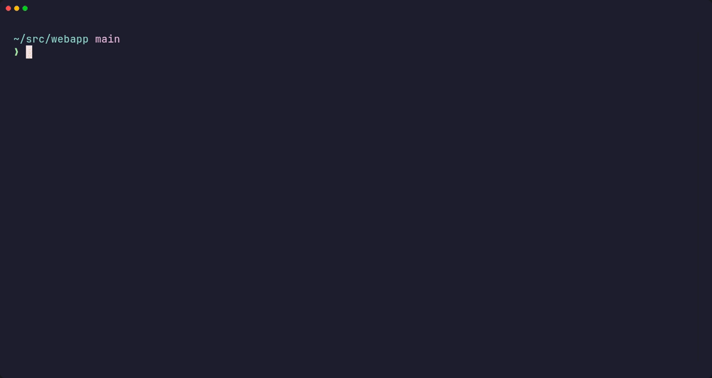

# bonsai 🪴

[](https://github.com/aymericbeaumet/bonsai/actions/workflows/release.yml)
[](https://github.com/aymericbeaumet/bonsai/releases/latest)
[](LICENSE)

**Work on two branches at once.** A bug report comes in halfway through a
feature. Leave the feature open in your editor and its tests running.
`bonsai add fix-login` gives the fix its own Git checkout, copies local
config such as `.env`, and installs dependencies from supported lockfiles.

Bonsai is a single Rust binary. Its terminal dashboard shows which checkouts
have changes, where coding agents are running, and how much disk each checkout
uses. It picks up worktrees you already created with Git or another tool.



Already use mise? From any of your repositories, try the dashboard in one
command. Press `?` for keys or `q` to quit.

```sh
mise x github:aymericbeaumet/bonsai@latest -- bonsai hq
```

## Install

**Homebrew** (macOS and Linux):

```sh
brew install aymericbeaumet/tap/bonsai
```

**mise** (Linux, macOS, and Windows):

```sh
mise use -g github:aymericbeaumet/bonsai
```

**Cargo** (Rust 1.99.1 or newer):

```sh
cargo install --locked --git https://github.com/aymericbeaumet/bonsai
```

All three install the `bonsai` command. Prebuilt binaries support Linux,
macOS, and Windows on amd64 and arm64; Linux binaries are statically linked.
You can also download them from
[GitHub Releases](https://github.com/aymericbeaumet/bonsai/releases/latest),
verify the archive against `SHA256SUMS`, and put the binary on your `PATH`.

## Quick start

Open a second terminal in a repository where you're working. Create a checkout
for the fix and check which branch you're on. This works in Bash or Zsh as soon
as the binary is installed.

```sh
cd "$(bonsai add fix-login)"
git branch --show-current   # fix-login
bonsai list --status
```

The list shows both checkout paths. Your first terminal is still on its
original branch with its uncommitted edits. Commit and push the fix from the
second terminal as usual. Once the fix lands, preview removal of its checkout
and local branch. Bonsai recognizes squash merges too.

```sh
bonsai clean fix-login --dry-run
```

### Shell integration

To make `bonsai add` and `bonsai cd` change directory directly and enable
completions, add the line for your shell to its startup file.

```sh
# zsh — ~/.zshrc
eval "$(bonsai init zsh)"

# bash — ~/.bashrc
eval "$(bonsai init bash)"

# fish — ~/.config/fish/config.fish
bonsai init fish | source
```

See the [first-worktree walkthrough](docs/getting-started.md) for stacked
branches, returning to a checkout, and reclaiming space after a merge.

## Commands

| Command | What it does |
|---|---|
| `bonsai add [branch]` | Create (or reuse) a branch and its worktree, then cd into it |
| `bonsai cd [query]` | Fuzzy-jump to a worktree, most recently used first |
| `bonsai list` | List the repository's worktrees (`--status`, `--json`) |
| `bonsai remove [target…]` | Delete chosen checkout directories; keep branches unless `-d` |
| `bonsai clean [target…]` | Delete merged or squash-merged checkout directories and their branches |
| `bonsai trim [target…]` | Delete ignored builds/dependencies; keep checkouts and branches |
| `bonsai prune [target…]` | Drop missing checkout registrations and delete orphan directories; keep branches |
| `bonsai` / `bonsai hq` | See and manage every project, worktree, and agent in a terminal UI |
| `bonsai ps` | List running coding agents and the worktree each works in |
| `bonsai start` / `resume` | Start or resume Claude Code, Codex, or OpenCode sessions |
| `bonsai workspace` | Print the `.code-workspace` file for VS Code-style editors |
| `bonsai skill` / `agents` | Teach your coding agents to use bonsai |

`-a` widens most commands to every project, and every command has a detailed
`--help`; `bonsai --help` groups them by task. `trim`, `clean`, and `prune`
share `-n`/`--dry-run`, `-y`/`--yes`, and `--json`. See the
[cleanup comparison and command reference](docs/commands.md#free-disk-or-remove-worktrees).

## Documentation

- [Getting started](docs/getting-started.md): your first worktree, safe previews, and common questions
- [Commands](docs/commands.md): reference, worktree-relative behavior, and safety guarantees
- [Configuration](docs/configuration.md): `.bonsai.toml`, `git config bonsai.*`, and environment variables
- [AI coding agents](docs/agents.md): Agent Skill, AGENTS.md, scripting, and session resume
- [Headquarters](docs/hq.md): the `bonsai hq` terminal UI, its columns, keys, and commands
- [Desktop editors](docs/editors.md): VS Code and Cursor workspaces, folder-based apps
- [Integrations](docs/integrations.md): shells, direnv, package managers, Cargo, and backups
- [How it works](docs/how-it-works.md): layout, repository ids, and the Rust library
- [Development](docs/development.md): building, testing, releases, and the demo

## License

[MIT](LICENSE)
